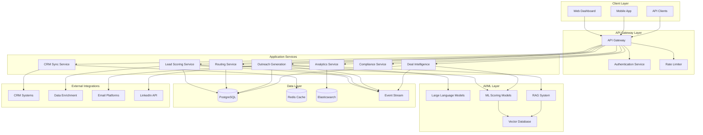

# Design Document

## Overview

The Sales & Lead Generation system is designed as a cloud-native, microservices-based platform that leverages AI/ML capabilities to automate and optimize the entire sales funnel. The system integrates with existing CRM platforms while providing intelligent lead qualification, automated outbound sequences, and real-time deal intelligence.

The architecture follows event-driven patterns with horizontal scalability, ensuring sub-200ms response times for lead scoring and real-time synchronization across integrated systems. The platform supports multi-tenant deployment with role-based access controls and comprehensive compliance monitoring.

## Architecture

### High-Level Architecture



### Service Architecture Patterns

**Microservices Design**: Each business capability is implemented as an independent service with its own data store and deployment lifecycle.

**Event-Driven Communication**: Services communicate through asynchronous events via Kafka, ensuring loose coupling and high availability.

**API-First Approach**: All services expose RESTful APIs with OpenAPI specifications and GraphQL endpoints for complex queries.

**Circuit Breaker Pattern**: External integrations implement circuit breakers to handle failures gracefully and maintain system stability.

## Components and Interfaces

### Lead Scoring Service

**Purpose**: Evaluates incoming leads against ICP criteria and assigns confidence scores.

**Key Components**:
- ICP Model Engine: Machine learning models trained on historical conversion data
- Data Enrichment Client: Integrates with external data providers for lead enhancement
- Scoring Algorithm: Multi-factor scoring with confidence intervals
- Caching Layer: Redis-based caching for sub-200ms response times

**API Interface**:
```json
POST /api/v1/leads/score
{
  "lead_data": {
    "company": "string",
    "contact": "object",
    "source": "string",
    "metadata": "object"
  },
  "icp_model_id": "string"
}

Response:
{
  "score": 85,
  "confidence": 0.92,
  "reasoning": "string",
  "enriched_data": "object",
  "routing_recommendation": "object"
}
```

### Outreach Generation Service

**Purpose**: Creates personalized, brand-consistent outreach messages across multiple channels.

**Key Components**:
- Message Generation Engine: GPT-4 based content creation with prompt engineering
- Brand Voice Validator: Ensures consistency with brand guidelines
- Personalization Engine: RAG-based context integration for prospect research
- A/B Testing Framework: Performance tracking and optimization

**API Interface**:
```json
POST /api/v1/outreach/generate
{
  "prospect": "object",
  "sequence_type": "email|linkedin|multi",
  "brand_profile": "string",
  "context": "object"
}

Response:
{
  "messages": [
    {
      "channel": "email",
      "subject": "string",
      "content": "string",
      "send_time": "datetime",
      "personalization_score": 0.89
    }
  ],
  "sequence_id": "string"
}
```

### Deal Intelligence Service

**Purpose**: Provides real-time deal analysis, risk assessment, and coaching recommendations.

**Key Components**:
- Probability Scoring Engine: ML models for deal closure prediction
- Risk Assessment Module: Identifies potential deal obstacles
- Competitive Intelligence: Market and competitor analysis integration
- Coaching Recommendation Engine: Next-best-action suggestions

**API Interface**:
```json
POST /api/v1/deals/analyze
{
  "deal_id": "string",
  "deal_data": "object",
  "historical_context": "object"
}

Response:
{
  "probability_score": 0.73,
  "risk_factors": ["array"],
  "recommendations": ["array"],
  "competitive_insights": "object",
  "forecast_impact": "object"
}
```

### CRM Sync Service

**Purpose**: Maintains real-time data synchronization between the platform and external CRM systems.

**Key Components**:
- Multi-CRM Connectors: Native integrations for Salesforce, HubSpot, Pipedrive
- Conflict Resolution Engine: Handles data conflicts with configurable rules
- Event Processing: Real-time change detection and propagation
- Bulk Operations Handler: Efficient processing of large data sets

**API Interface**:
```json
POST /api/v1/crm/sync
{
  "crm_type": "salesforce|hubspot|pipedrive",
  "operation": "create|update|delete",
  "entity_type": "lead|contact|opportunity",
  "data": "object"
}

Response:
{
  "sync_id": "string",
  "status": "success|conflict|error",
  "conflicts": ["array"],
  "resolution": "object"
}
```

## Data Models

### Lead Data Model

```json
{
  "id": "uuid",
  "company": {
    "name": "string",
    "domain": "string",
    "industry": "string",
    "size": "number",
    "revenue": "number",
    "location": "object"
  },
  "contact": {
    "name": "string",
    "email": "string",
    "title": "string",
    "linkedin_url": "string",
    "phone": "string"
  },
  "source": {
    "channel": "string",
    "campaign": "string",
    "medium": "string"
  },
  "scoring": {
    "icp_score": "number",
    "confidence": "number",
    "reasoning": "string",
    "model_version": "string"
  },
  "enrichment": {
    "technographics": "object",
    "intent_signals": "array",
    "social_presence": "object"
  },
  "timestamps": {
    "created_at": "datetime",
    "updated_at": "datetime",
    "last_enriched": "datetime"
  }
}
```

### Outreach Sequence Model

```json
{
  "id": "uuid",
  "prospect_id": "uuid",
  "sequence_type": "string",
  "brand_profile": "string",
  "messages": [
    {
      "id": "uuid",
      "channel": "email|linkedin|phone",
      "template_id": "uuid",
      "content": "string",
      "subject": "string",
      "scheduled_time": "datetime",
      "sent_time": "datetime",
      "status": "draft|scheduled|sent|delivered|opened|replied",
      "personalization_data": "object",
      "performance_metrics": {
        "open_rate": "number",
        "click_rate": "number",
        "reply_rate": "number"
      }
    }
  ],
  "performance": {
    "total_sent": "number",
    "total_opened": "number",
    "total_replied": "number",
    "conversion_rate": "number"
  }
}
```

### Deal Intelligence Model

```json
{
  "id": "uuid",
  "deal_id": "string",
  "crm_source": "string",
  "analysis": {
    "probability_score": "number",
    "confidence_interval": "object",
    "stage_progression": "object",
    "velocity_metrics": "object"
  },
  "risk_assessment": {
    "risk_score": "number",
    "risk_factors": ["array"],
    "mitigation_strategies": ["array"]
  },
  "recommendations": {
    "next_actions": ["array"],
    "coaching_points": ["array"],
    "resource_needs": ["array"]
  },
  "competitive_intelligence": {
    "competitors": ["array"],
    "win_probability": "number",
    "differentiation_points": ["array"]
  },
  "forecast_impact": {
    "revenue_impact": "number",
    "timeline_impact": "string",
    "resource_impact": "object"
  }
}
```

## Error Handling

### Error Classification

**System Errors**: Infrastructure failures, service unavailability, database connection issues
- Response: 5xx HTTP status codes with retry mechanisms
- Handling: Circuit breaker activation, fallback to cached data, alert generation

**Client Errors**: Invalid requests, authentication failures, rate limit exceeded
- Response: 4xx HTTP status codes with descriptive error messages
- Handling: Request validation, user guidance, quota management

**Business Logic Errors**: ICP model failures, CRM sync conflicts, compliance violations
- Response: 422 HTTP status codes with business context
- Handling: Graceful degradation, manual review queues, audit logging

### Error Response Format

```json
{
  "error": {
    "code": "LEAD_SCORING_FAILED",
    "message": "Unable to score lead due to insufficient data",
    "details": {
      "missing_fields": ["company.revenue", "contact.title"],
      "suggestions": ["Enable data enrichment", "Request additional information"]
    },
    "request_id": "uuid",
    "timestamp": "datetime"
  }
}
```

### Retry and Fallback Strategies

**Exponential Backoff**: For transient failures with jitter to prevent thundering herd
**Circuit Breaker**: Fail-fast mechanism for external service dependencies
**Graceful Degradation**: Reduced functionality when non-critical services are unavailable
**Cached Responses**: Serve stale data when real-time updates are unavailable

## Testing Strategy

### Unit Testing

**Coverage Target**: 90% code coverage for all services
**Framework**: Jest for Node.js services, pytest for Python services
**Mocking**: External dependencies mocked with realistic response patterns
**Test Data**: Synthetic data generation for consistent test scenarios

### Integration Testing

**API Testing**: Automated testing of all REST and GraphQL endpoints
**Database Testing**: Transaction integrity and performance testing
**Event Testing**: Kafka message processing and ordering verification
**CRM Integration**: Mock CRM responses for all supported platforms

### Performance Testing

**Load Testing**: Simulate 10,000+ concurrent users with realistic usage patterns
**Stress Testing**: Identify breaking points and resource limitations
**Latency Testing**: Verify sub-200ms response times for critical paths
**Scalability Testing**: Horizontal scaling validation under increasing load

### Security Testing

**Penetration Testing**: Quarterly security assessments by third-party vendors
**Vulnerability Scanning**: Automated scanning in CI/CD pipeline
**Compliance Testing**: GDPR, CCPA, and SOC 2 requirement validation
**Authentication Testing**: Multi-factor authentication and session management

### End-to-End Testing

**User Journey Testing**: Complete workflows from lead capture to deal closure
**Cross-Service Testing**: Multi-service interactions and data consistency
**Mobile Testing**: iOS and Android app functionality and performance
**Browser Testing**: Cross-browser compatibility and responsive design

### Monitoring and Observability

**Application Metrics**: Response times, error rates, throughput measurements
**Business Metrics**: Lead conversion rates, message performance, deal velocity
**Infrastructure Metrics**: CPU, memory, disk, and network utilization
**Custom Dashboards**: Real-time visibility into system health and performance

**Alerting Strategy**:
- Critical: System outages, security breaches, compliance violations
- Warning: Performance degradation, high error rates, capacity thresholds
- Info: Deployment notifications, scheduled maintenance, usage reports